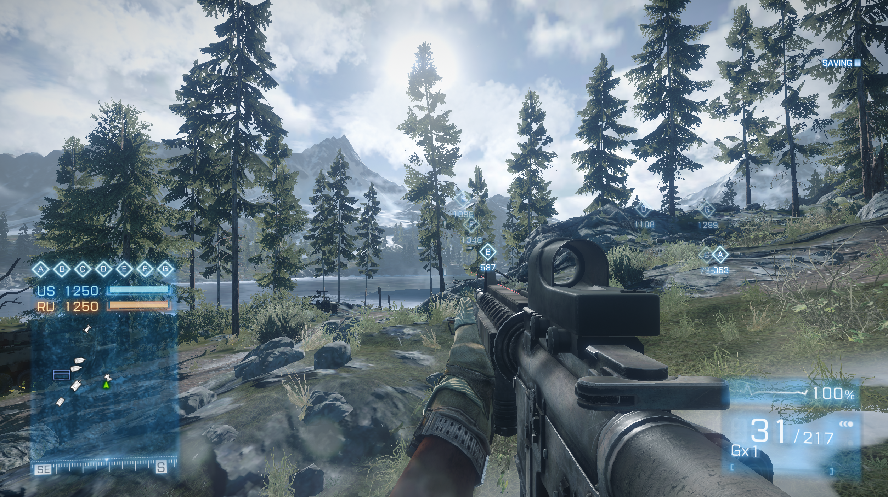
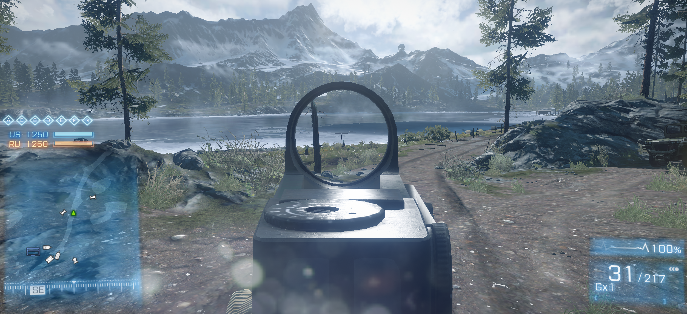
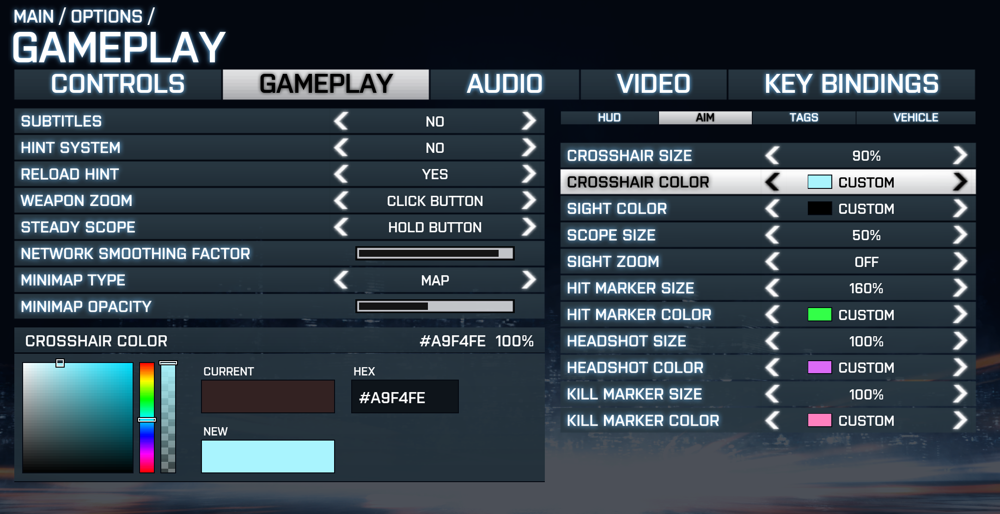

# bf3 hud fix

Battlefield 3 lays its Scaleform HUD out at a fixed 1280x720 once the screen is at least that big, so from full HD
up it looks tiny. hudfix scales the whole HUD to your resolution and adds per-element size, opacity and color options,
all set from the game's own options menu.

## Preview

In game, with the HUD scaled up:

Aiming down with customs scope and without fov scaling:

The options in the **Gameplay** tab:

## Features

### HUD scale

- **Auto HUD scale**: `min(width / 1280, height / 720)`, so the HUD keeps its 720p proportions at any resolution
- **Manual HUD scale**: set it exactly, bigger or smaller
- The glyph cache is enlarged (1024 -> 2048) so scaled fonts stay sharp

### Per-element size (50% - 300%, 10% steps)

- minimap (with its background and compass) and the icons on it
- squad list
- tickets and objective bar
- crosshair
- hit markers, separately for a hit, a headshot and a kill
- kill log
- score popup (the score counter and the messages in the middle, like ENEMY KILLED 100)
- award popups (ribbons and medals)
- team and enemy nametags (separately)
- team and enemy health bars (separately, on top of their nametag size)
- man down / revive icons (on top of the team nametag size)
- objective flags in the world (icon, letter and distance)
- ammo and health (including vehicle health and passenger list)
- chat
- commo rose (its options stay pickable at any size)
- vehicle crosshair in 1st person; moving aim markers stay on target
- vehicle crosshair in 3rd person (chase cam): its lines get thinner or thicker, the brackets keep the game's spacing
- the rest of the vehicle HUD

The bottom-left widgets follow the minimap: the tickets, squad list and chat sit against its edge at their own size,
and the panel behind the minimap stretches over the tickets. **Remove ticket panel** drops the panel behind the
tickets instead (on foot it ends at the minimap, in air vehicles it is hidden).

### Opacity

- **Per-element opacity** (0% - 100%, 10% steps) for the same elements
- **Map BG opacity**: the panel behind the minimap (and the tickets); the map itself fades with the game's own
  minimap opacity option
- **Opacity when scoped** (0% - 100% of the element's opacity) for team and enemy nametags, team and enemy health bars,
  revive icons and flags

### Aiming

- **Sight zoom**: what aiming does to your field of view
  - **GAME**: each zoom level's own fixed field of view, as the game does it (the field of view slider is ignored)
  - **SCALED**: the zoom levels follow the field of view slider
  - **OFF**: iron sights, red dots, holos and other unmagnified sights keep the hipfire field of view, so the world no
    longer shrinks when you aim; magnified scopes still zoom as in the game
- **Uniform aiming** crosshair sens = aiming sens
- **Zoom sensitivity** (10% - 300%, 5% steps): a multiplier on the aiming and scoped sensitivity, on top of either
- **Sight color** for red dot and holo dots and the lit marks of scopes (the ACOG's triangle), with the game's own glow;
  the lines of magnified scopes keep their own
- **Scope size** (50% - 150%, 2% steps): the size of the sight's and scope's reticle
- **Uniform sights**: the same sight shows its reticle at the same size on every gun (the game's size depends on how
  far the sight sits from your eye and on the gun's aiming field of view)

### Visuals

- **No blue tint**: the maps' color correction at neutral (contrast, saturation and brightness at 1)
- **No color grading**: the maps' color grading texture off

For more visual edits use [bf-visual-editor](https://github.com/Bartis1313/bf-visual-editor).

### Colors

Default or any color from a color picker (with a hex field) for the crosshair, the 1st and 3rd person vehicle
crosshair, the vehicle HUD and the hit markers, with separate hit marker colors for a hit, a headshot and a kill
(a headshot kill counts as a kill)

- The color tints the widget's own colors, so white parts take the color and dark parts stay dark.
- The 1st person vehicle HUD's art is moved to the color. Where it is drawn into a cockpit's HUD mesh, the mesh's
  yellow-green shader is swapped for an even one, so the color shows as picked at the game's own brightness, in every
  vehicle and seat, right away.
- **Vehicle brightness** (50% - 200%): how bright a colored vehicle HUD is, 100% being the game's own

### Performance fixes

- **FPS drops**: the game's performance overlay asks Windows for system memory stats (`GetPerformanceInfo`) on every
  frame, which hurts mostly on modern CPUs. hudfix refreshes it once per second instead.
- **Chatbox lag**: chat lines never expire, the chat keeps up to 200 of them, and every new line resends the whole
  list to the UI. Once the chat fills up, each message stalls the game. hudfix caps the chat at 20 lines
  (credits [FlashHit](https://github.com/FlashHit)).

### Gameplay fixes

- **Crabwalk / unkillable revived players** (credits gm_fix).
- **Flag capture progress** (credits [FlashHit](https://github.com/FlashHit)).

### Game option fixes

- **Field of view**: the slider goes up to 120 instead of 90, and a change applies right away instead of on your next
  aim or respawn.
- **Minimap opacity**: the game's option only faded the satellite detail texture, which the default minimap type doesn't
  draw, so it did nothing. Now it fades the whole map texture (base map and vegetation too).

## Settings

All options live in the game's **Gameplay** options tab, split into HUD, AIM, TAGS and VEHICLE pages. They are saved
in your game profile next to the rest of the gameplay settings (keys `HudFixAuto`, `HudFixScale`, `HudFixMinimap`,
...), so there is no extra config file, and they are applied like the game's own settings.

## Download

No need to build it yourself: prebuilt DLLs are in the [`build`](build) folder.

- `Engine.BuildInfo_Win32_Retail_dll.dll` - hudfix
- `Engine_BuildInfo_orig.dll` - the game's original `Engine.BuildInfo_Win32_Retail_dll.dll`, renamed

Back up the game's `Engine.BuildInfo_Win32_Retail_dll.dll`, then copy both files into the Battlefield 3 folder
(e.g. `C:\Program Files\EA Games\Battlefield 3`) and overwrite. That's the whole install; the steps below are only
needed for a DLL you built yourself.

## Install

hudfix is a proxy for `Engine.BuildInfo_Win32_Retail_dll.dll`.

1. In the Battlefield 3 folder, rename the original `Engine.BuildInfo_Win32_Retail_dll.dll` to
   `Engine_BuildInfo_orig.dll`. hudfix forwards `getBuildInfo` to it.
2. Copy the built `Engine.BuildInfo_Win32_Retail_dll.dll` into the Battlefield 3 folder.
3. Start the game. A log is written to `Documents\Battlefield 3\hudfix.log`.

To uninstall, delete the hudfix DLL and rename `Engine_BuildInfo_orig.dll` back.

Only the retail `bf3.exe` 1.6.0.0 is supported; every hook is a fixed address in that build.

## Build

Requirements: Visual Studio and [vcpkg](https://vcpkg.io) with MSBuild integration.
The only dependency is [MinHook](https://github.com/TsudaKageyu/minhook), installed from `vcpkg.json`
(`x86-windows-static`).

Open `hudfix.sln` and build **Release | Win32**. The DLL lands in `Release\`; nothing copies it to the game folder
for you.

## Few notes on the implementation
Menu code might be ghetto, because getting edits on scaleform is extremely painful...
As well as the shader solutions, you can use [bf-visual-editor](https://github.com/Bartis1313/bf-visual-editor) for more in-depth edits and more RE wise
